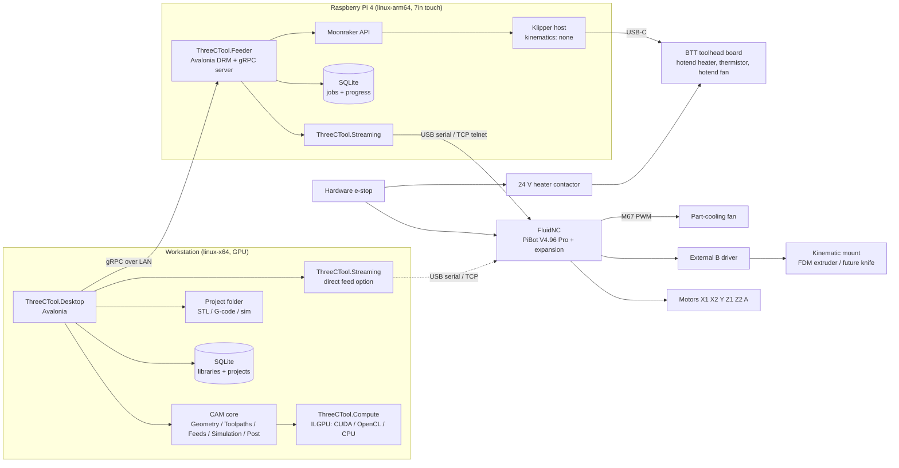
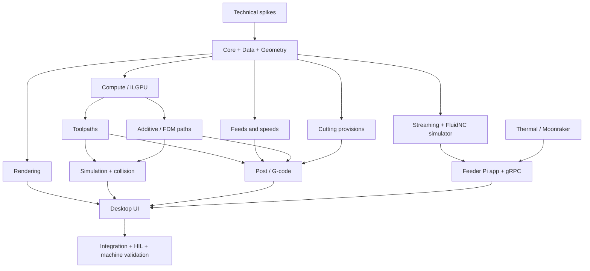

# 3C Tool – Project Plan

**3C Tool** – Classic Car EVO CNC Control Tool. Code identifier: `ThreeCTool` (namespaces, assemblies, solution). Repository: `3CTool` (private, GitHub).

STL → G-code CAM application for a 4-axis (X, Y, Z, A) GRBL/FluidNC multi-process machine: milling spindle (permanent), FDM print head (kinematic mount) and – in the future – a cutting knife (kinematic mount). Includes drip-feeding and stop/e-stop recovery.

Status: **Planning**. All decisions in section 2 were confirmed by the product owner. Section 14 lists the resolved open questions.

---

## 1. Goals

1. Load an STL, manipulate it (rotate, scale, translate, auto-orient/place, repair) and position it on stock.
2. Generate G-code that takes available tooling, material and machine capabilities into account to get the best result according to a per-project optimization goal.
3. Manage a tool library; select which tools are available for each project.
4. Select target material; feeds & speeds are optimized automatically and improve over time from job feedback.
5. Respect machine capabilities (travel, steps/mm, max rates, acceleration, spindle range/power, A-axis geometry) – all configurable in machine profiles.
6. Generate one G-code file **per tool per setup/orientation**.
7. Drip-feed FluidNC from a Raspberry Pi (or directly from the desktop), with restart after stop and after a hard e-stop.
8. Use GPU (CUDA / AMD via OpenCL) for heavy computation, with a mandatory CPU fallback.
9. FDM printing with the same machine: planar, rotary (A-axis), non-planar, and hybrid (mill a block, then "skin" it with FDM; or print, then mill) within one project.
10. Prepare the architecture for a future knife head (prepreg carbon fiber cutting).

Delivery: complete feature set at first release (no MVP / phased feature rollout). Section 13 describes build order only.

---

## 2. Confirmed decisions

| Topic | Decision |
|---|---|
| Runtime | .NET 10 (LTS), C# |
| Platforms | Platform independent, Linux primary (desktop: linux-x64; feeder: linux-arm64) |
| Database | SQLite, embedded, via EF Core (migrations) |
| Desktop UI | Avalonia UI |
| 3D rendering | OpenGL via Silk.NET in Avalonia `OpenGlControlBase`; shaders restricted to OpenGL ES 3.0 subset so the renderer also runs on the Pi |
| Deployment | Workstation for CAM + Raspberry Pi 4 (7" touchscreen) as drip-feeder with its own Avalonia UI |
| Desktop ↔ Pi | gRPC over LAN (job upload, control, streaming status) |
| Direct feed | Desktop can also drip-feed FluidNC directly (no Pi) |
| Pi ↔ FluidNC | USB serial and WiFi/Ethernet telnet (TCP), selectable |
| Users | Single user, no login |
| UI language | English only |
| GPU | ILGPU (C# kernels): CUDA backend (NVIDIA RTX 2080), OpenCL backend (AMD Radeon 8060S via ROCm OpenCL), CPU accelerator as mandatory fallback |
| Toolpath engine | Written from scratch in C# (no OpenCAMLib) |
| 3rd-party libs | Allowed if pure C# and MIT-compatible license (e.g. Clipper2, MathNet.Numerics, geometry3Sharp) |
| License | MIT |
| Source control / CI | GitHub + GitHub Actions |
| Storage of files | STL / G-code / simulation data as files in a project folder; SQLite stores metadata and paths |
| DB layout | Central library DB (machines, tools, materials, learned corrections) + per-project `project.db` in the project folder with a snapshot of used machine/tools/material (portable, reproducible) |
| Desktop ↔ Pi security | Pairing token (code shown on Pi touchscreen) + TLS with self-signed Pi certificate, fingerprint pinned at pairing |
| Desktop packaging | Linux AppImage, Windows installer (MSI/Inno Setup) |
| Pi packaging | .deb package + systemd service, auto-start in kiosk mode |
| GPU tests in CI | Self-hosted GitHub runner on the GPU workstation; trusted branches only, never fork PRs |
| FluidNC version | Target latest stable FluidNC; version read and logged on connect; warning if older than the minimum tested version |
| Post-processor | FluidNC only; `IPostProcessor` abstraction kept so other dialects can be added later |
| Units | Metric (mm) only for output; tool dimensions may be entered in inch (e.g. 1/8", 1/4") and are converted |
| STL import units | Assume mm, show bounding-box size on import; user can switch unit (mm / cm / m / inch) |

### Machining
| Topic | Decision |
|---|---|
| A-axis modes | 3-axis only, indexed 3+1, simultaneous 4-axis |
| Strategies | Adaptive/trochoidal roughing, Z-level pocket/raster roughing, parallel/raster finishing, waterline/contour finishing, scallop (constant stepover) finishing, rest machining, pencil/corner cleanup, rotary roughing/finishing (spiral around A) |
| Optimization goal | Selectable per project: quality vs. speed vs. tool life |
| Tool types | Flat end, ball end, bull nose, V-bit, tapered ball, chamfer mill |
| Tool holding | Collets for 1/8", 1/4", 6 mm, 8 mm shanks (configurable) |
| Stock | Box, cylinder, stock from STL, in-process stock carried between operations |
| Workholding | Keep-out zones (boxes/cylinders) |
| Collision checks | Tool shank/holder vs. part & stock; tool/holder vs. keep-out zones; machine travel limits |
| Simulation | Toolpath preview + GPU material-removal simulation + gouge/deviation comparison to STL |
| G-code | Arc fitting G2/G3 (configurable per machine profile, default on); linear-only option; inverse-time feed G93 for simultaneous A moves; mm only |
| File split | One file per tool per setup/orientation |
| Mesh ops | Rotate/scale/translate, auto-orient/place on stock or rotary axis, mesh repair |
| Tolerances | Project defaults (overridable per operation), scaled per material: see section 8.1 |

### Machine (initial profile, all configurable; multiple profiles supported)
| Item | Value |
|---|---|
| Travel | X 1300 mm, Y 750 mm, Z 650 mm |
| A-axis | Rotary around X; max workpiece Ø 400 mm, max length 1000 mm, center height adjustable 160–250 mm |
| Homing | X, Y, Z have homing switches; A is zeroed manually |
| Spindle | Manual speed dial (continuous), 1500–30000 RPM, 2200 W; software tells operator the RPM |
| Coolant / dust | Configurable per profile: none / M7 / M8 / dust extraction M-code |
| Steps/mm, °/step, max rates, accelerations, travel, homing | Owned by FluidNC `config.yaml` (controller is source of truth). 3C Tool imports them into the machine profile and warns on mismatch at every connect |
| Spindle power curve | Generic constant-torque curve, rated 2.2 kW at 24000 RPM (power ∝ RPM below rated, constant above), editable |
| Arc fitting | Per profile, default on |

### Drip-feed and recovery
| Topic | Decision |
|---|---|
| Tool change | Manual between files; tool length probe at start of each file |
| Probe method | Fixed tool setter **and** touch plate on workpiece, configurable per machine profile |
| Recovery | Automatic resume after re-home, with operator confirmation steps |
| A after e-stop | Trust stepper position (A assumed not to move / lose steps) |
| Pi power loss | UPS / safe-shutdown HAT **and** progress persisted to SQLite (WAL + fsync) after every acknowledged line |
| Pi controls | Start, pause, resume, stop, feed override, jogging, homing, probing |
| Spindle override | Not offered (manual dial). Operator enters the actual dial RPM on the Pi when changed; logged |
| Pi preview | 3D toolpath preview of the running file with progress highlight and tool position (decimated for large files) |
| Job feedback | Operator rating (finish, chatter, wear), automatic logging of feed overrides and RPM changes, tool wear/breakage log |

### Toolheads (multi-process)
| Topic | Decision |
|---|---|
| Heads | Spindle permanently mounted; FDM head and future knife head on a manual kinematic mount (one at a time) |
| First release | Mill + FDM fully; knife: architecture provisions only |
| Head identification | Operator confirms the mounted head before each file; each file header declares the required head |
| Head offsets | FDM nozzle probed on the fixed tool setter for Z at the start of every file; XY offset calibration routine once per mount |
| Spindle during printing | Operator must remove the cutter; system prompts and requires confirmation |
| 7th motor | Shared FluidNC **B axis** for the interchangeable heads (FDM extruder now, knife blade rotation later); external step/dir driver (e.g. TMC2209 module / DM542) on PiBot expansion outputs; motor connector at the kinematic mount |
| B-axis units | Fixed steps/unit in FluidNC; the post-processor converts per head (FDM: mm filament, knife: degrees) |
| File split | One file per tool/head per setup/orientation |

### FDM printing
| Topic | Decision |
|---|---|
| Toolhead | BIQU/BTT USB-C toolhead board (exact model to be confirmed) |
| Motion | FluidNC (PiBot V4.96 Pro + expansion board); extrusion on the B axis in the same planner as X/Y/Z/A |
| Heaters | Klipper with `kinematics: none` on the Pi, only for hotend heater, thermistor, hotend fan (and optional bed); toolhead board connected to the Pi via USB-C; feeder talks to Klipper via the Moonraker API |
| Part-cooling fan | FluidNC synchronized PWM output (`M67`) on the PiBot/expansion board |
| Print feed mode | Inverse time (`G93`) for all print moves: exact segment timing regardless of how FluidNC combines X/Y/Z/A/B in its feed calculation |
| Pressure advance | Software compensation in the path generator (FluidNC has none) |
| Path generation | Own C# generator for everything (no PrusaSlicer) |
| Print profiles | 3C Tool-native filament and print profiles (layer height, line widths, temperatures, speeds, retraction, cooling, supports, infill) |
| Filaments | PLA, PETG, ABS/ASA, TPU, PA, CF/GF-filled (PLA-CF, PETG-CF, PA-CF), PC |
| Nozzle | Single fixed nozzle, configured in the FDM head profile |
| Bed | Steel machine table (unheated) by default; optional heated build plate |
| Print modes | Planar on bed; rotary on the A-axis; non-planar (curved layers); hybrid print → mill and mill → print in the same project |
| Slicing features | Perimeters with seam control, top/bottom solid layers, infill (rectilinear, grid, gyroid, honeycomb), normal and tree supports, bridging detection, adaptive layer height, ironing, brim/skirt/raft, retraction/wipe/z-hop |
| Non-planar | Conformal layers following milled/existing surfaces; max slope from toolhead geometry, steeper areas handled by A-axis rotation; planar core + non-planar top skin; rotary layers wrapped around the A-axis |
| Skin definition | All supported: (1) two STLs, printed volume = outer shape minus core *as milled*; (2) selected surfaces of the milled part + skin thickness; (3) multi-body 3MF (or multi-solid STL) with bodies tagged *mill* / *print* |
| Print recovery | Resume after pause/stop only; after an e-stop a print job is aborted (heaters off) |
| E-stop | **Hardware requirement**: e-stop also cuts 24 V to hotend heater and bed (contactor/relay); software heater shutdown as extra layer |

### Knife (future – provisions in first release)
| Topic | Decision |
|---|---|
| Knife type | Not decided (drag / tangential / oscillating tangential) |
| Provisions | Head abstraction supports a knife head (process type, B-axis blade angle, offsets); DXF/SVG importer; data model for ply book, flattening and nesting (no algorithms); post-processor hooks for tangential blade angle (B) and oscillation M-code |
| Future scope | 2D DXF/SVG input, ply shapes flattened from STL, automatic nesting on the prepreg sheet, ply book / layup schedule |

---

## 3. Architecture



### 3.1 Solution layout

```
ThreeCTool.slnx
src/
  ThreeCTool.Core/             Domain model (machine, tools, materials, project, setups, operations), units, interfaces
  ThreeCTool.Data/             EF Core SQLite context, migrations, repositories
  ThreeCTool.Geometry/         STL I/O, mesh, transforms, repair, BVH, slicing, polygons (Clipper2), kinematics (A rotation)
  ThreeCTool.Compute/          ILGPU accelerator selection, kernels, CPU fallback, device diagnostics
  ThreeCTool.Toolpaths/        Cutter models, drop-cutter, waterline, all strategies, linking, lead-in/out
  ThreeCTool.Feeds/            Feeds & speeds engine, material library, learning from feedback
  ThreeCTool.Additive/         FDM path generation: planar slicing, non-planar/conformal, rotary, supports, infill, pressure-advance compensation
  ThreeCTool.Cutting/          Knife provisions: ply book / flattening / nesting data model and interfaces (no algorithms yet)
  ThreeCTool.Thermal/          Moonraker client: heater/fan control, temperature monitoring, heater safety shutdown
  ThreeCTool.Simulation/       Tri-dexel stock, material removal, deviation/gouge analysis, collision checks
  ThreeCTool.Post/             IPostProcessor + FluidNC post, arc fitting, G93, file splitting, time estimation
  ThreeCTool.Rendering/        Shared OpenGL (ES 3.0 subset) renderer: mesh, toolpaths, stock, heatmaps
  ThreeCTool.Streaming/        FluidNC protocol, serial/TCP transports, streamer, recovery engine (shared desktop + Pi)
  ThreeCTool.Feeder.Contracts/ gRPC .proto files and generated client/server code
  ThreeCTool.Desktop/          Avalonia desktop application (CAM UI + optional direct feed + feeder remote control)
  ThreeCTool.Feeder/           Pi application: gRPC server + Avalonia touch UI (DRM/KMS, no X required)
tests/
  ThreeCTool.*.Tests/          xUnit per project
  ThreeCTool.FluidNcSimulator/ Emulated FluidNC (serial-over-pty + TCP) for streaming/recovery tests
  ThreeCTool.MoonrakerMock/    Emulated Moonraker/Klipper (temperatures, heater faults, shutdown) for feeder tests
  ThreeCTool.Gpu.Tests/        GPU-vs-CPU equivalence tests (tolerance based)
```

---

## 4. Domain and data model (SQLite / EF Core)

Central library DB (`~/.local/share/3CTool/library.db` on Linux): MachineProfile, AxisConfig, SpindleConfig, Toolhead, FdmHeadProfile, KnifeHeadProfile, Collet/Holder, Tool, Material, Filament, PrintProfile, FeedCorrection, ToolWearLog, JobFeedback, known feeders (pairing token, pinned certificate fingerprint).

Per-project DB (`<project folder>/project.db`): Project, ProjectTool, PartModel, Stock, KeepOutZone, Setup, Operation (incl. PrintOperation), ToolpathResult, GcodeFile, knife provisions (Ply, PlyBook, FlatPattern, NestLayout), plus a snapshot of the machine profile, tools and material used, so a project can be copied, archived and regenerated identically even after the library changes. On open, differences between snapshot and library are shown and the user can update the snapshot.

Entities:

- **MachineProfile**: name, linked controller (FluidNC version, last import time, imported config hash), travel per axis, A-axis center (Y, Z) per center-height setting, A max Ø/length, homing config, soft limits, safe Z (machine coords), probe config (setter XY/Z, touch plate thickness, probe feed rates), coolant/dust M-codes, arc-fitting on/off + tolerance, connection defaults.
- **AxisConfig**: steps/mm or steps/°, max rate, acceleration, travel, direction, homing – imported from FluidNC, read-only in 3C Tool.
- **SpindleConfig**: min/max RPM, rated power, power curve (constant-torque/constant-power points), manual-dial flag. Initial: 1500–30000 RPM, 2.2 kW rated at 24000 RPM.
- **Toolhead**: type (spindle / FDM / knife), mount (fixed / kinematic), calibrated XYZ offset vs. spindle (+ calibration date), B-axis usage and unit conversion, collision model (nozzle, heater block, fan duct, mount as simple solids), required operator confirmations.
- **FdmHeadProfile**: nozzle diameter, max temperature, max volumetric flow, filament diameter, B-units per mm filament, pressure-advance factor, Klipper heater/fan object names, part-fan `M67` output index, nozzle probe settings.
- **KnifeHeadProfile** (provision): knife type, blade offset (drag), B-units per degree, oscillation M-code, corner lift angle.
- **Collet/Holder**: shank sizes supported (1/8", 1/4", 6 mm, 8 mm), holder geometry (for collision checks).
- **Tool**: type, diameter, corner radius, taper/tip angle, tip diameter, flute count, flute length, shank Ø, overall length, stickout, tool material (carbide/HSS), coating, helix, max DOC, status (in stock / worn / broken).
- **Material**: category, hardness, specific cutting force (kc1.1, mc), cutting data per tool material (surface speed range, chip load vs. diameter table), max DOC/WOC guidelines, notes. Built-in, user-editable, user-addable.
- **Filament**: type, diameter, nozzle/bed temperature ranges, density, max volumetric speed, cooling settings, shrinkage, notes. Built-in, user-editable, user-addable.
- **PrintProfile**: layer height (fixed/adaptive), line widths, perimeters, seam, top/bottom layers, infill pattern/density, speeds, accelerations, retraction/wipe/z-hop, supports (normal/tree), bridging, brim/skirt/raft, ironing, minimum layer time.
- **FeedCorrection**: learned correction factors per (material, tool, operation type).
- **Project**: name, folder path, machine profile, material, filament, optimization goal, tolerances.
- **ProjectTool**: tools selected as available for this project.
- **PartModel**: STL path, SHA-256, transform (rotation, scale, translation), repair report.
- **Stock**: type (box / cylinder / STL), dimensions, path, placement.
- **KeepOutZone**: box/cylinder, placement, attached to machine or setup.
- **Setup**: orientation (3-axis / indexed A angle / simultaneous rotary), WCS, probe method, ordered operations.
- **Operation**: strategy, tool, parameters (stepover, stepdown, tolerance, stock-to-leave, boundaries), computed feeds/speeds, order.
- **PrintOperation**: mode (planar / non-planar / rotary / skin), printed-volume source (outer STL minus milled core / selected surfaces + thickness / tagged body), print profile, filament, substrate (bed / simulated in-process stock).
- **Ply, PlyBook, FlatPattern, NestLayout** (knife provisions, data model only): ply shape, material, fiber orientation, sequence, source (DXF/SVG / flattened surface), sheet layout.
- **ToolpathResult**: input hash, path to cached toolpath file, statistics.
- **GcodeFile**: setup, tool, path, SHA-256, line count, RPM, estimated time.
- **JobFeedback**: ratings (finish, chatter, wear), notes, imported override/RPM logs from feeder.
- **ToolWearLog**: tool, runtime minutes, cut length, wear/breakage events.

Feeder DB (Pi): Job, JobFile (G-code copy + hash, required head), JobProgress (last sent / acked / estimated executed line, last MPos, modal state snapshot, work offsets, heater setpoints), JobEvent (state changes, alarms, overrides, RPM changes, heater events, operator confirmations incl. head mounted / cutter removed).

---

## 5. Geometry

- STL reader (binary + ASCII), vertex welding, normals.
- Import units: assume mm; import dialog shows the bounding-box size and lets the user switch to cm / m / inch.
- 3MF import (multi-body, bodies tagged *mill* / *print*); multi-solid ASCII STL with solid names as tags.
- DXF / SVG 2D import (knife provisions).
- Volume operations for hybrid jobs in dexel/voxel space (e.g. printed volume = outer shape minus simulated milled stock; surface offset for skin thickness).
- Transforms: rotate (free + 90° snaps), uniform scale, translate; history kept in project.
- Auto-orient / place: place on stock top/bottom/center; align on A-axis (center the mesh on the rotation axis, fit inside cylinder stock); suggest orientations minimizing undercuts for 3-axis/3+1.
- Mesh repair: hole filling, non-manifold edges, duplicate/degenerate triangles, flipped normals; report shown to user.
- Spatial structures: BVH and XY uniform grid (GPU-friendly flat arrays).
- Kinematics: part ↔ machine coordinates with A rotation about an X-parallel axis through the configured center (Y, Z).

---

## 6. GPU compute (ILGPU)

- Accelerator selection at startup: CUDA → OpenCL → CPU; user can override in settings; diagnostics page shows device, memory, backend.
- All kernels have a CPU implementation (ILGPU CPU accelerator or parallel C#) used as fallback and as reference in tests.
- GPU workloads:
  - Drop-cutter for all cutter shapes over CL grids (raster, scallop, rotary).
  - Push-cutter / fibers for waterline.
  - Engagement-angle evaluation for adaptive clearing.
  - Tri-dexel material removal simulation.
  - Deviation computation (stock surface vs. STL distance).
  - Collision sweeps (holder/shank vs. stock; FDM toolhead model vs. part/stock/print).
  - FDM: tree-support generation, conformal layer distance fields, surface projection for non-planar paths.
- Large jobs are tiled to fit GPU memory (the 8060S shares system memory; the 2080 has 8 GB).
- GPU and CPU results are compared with tolerances, never bit-exact (floating-point reduction order differs).

---

## 7. Toolpath strategies

Cutter model: generalized APT-style profile (flat, ball, bull, cone, tapered ball, chamfer) with exact contact tests against vertex/edge/facet.

| Strategy | Approach |
|---|---|
| Adaptive / trochoidal roughing | Per Z-level: slice stock and part (Clipper2 offsets), constant-engagement path generation, engagement evaluated on GPU raster |
| Z-level pocket / raster roughing | Per Z-level offset or raster fill of stock-minus-part region |
| Parallel / raster finishing | GPU drop-cutter on CL grid, adaptive sampling, configurable angle |
| Waterline / contour | Push-cutter fibers per Z, loop reconstruction, adaptive Z steps on flat areas |
| Scallop (constant stepover) | Offset curves on CL surface by 3D distance (GPU distance field), isolines |
| Rest machining | Remaining material from in-process stock model; restrict to regions left by previous tools |
| Pencil / corner | Detect double-contact (concave) regions on CL surface, follow as chains |
| Rotary roughing / finishing | Cylindrical CL map r(x, θ) by radial drop-cutter; spiral or ring patterns; simultaneous A |
| Indexed 3+1 | Rotate part to A angle, run 3-axis strategies, A move between setups/files |

Common: linking (stay-down vs. retract), lead-in/out, ramp/helix entry, stock-to-leave, boundaries, tolerances, minimum safe heights, travel limit checks.

### 7.1 FDM path generation (ThreeCTool.Additive)

| Mode | Approach |
|---|---|
| Planar | Mesh slicing per layer (fixed or adaptive height), Clipper2 polygons, perimeters with seam placement, top/bottom detection, infill (rectilinear, grid, gyroid, honeycomb), bridging detection, supports (normal with interface layers; tree supports GPU-accelerated), brim/skirt/raft, ironing, travel optimization with retraction/wipe/z-hop |
| Non-planar (conformal) | Layers as offset surfaces from a base surface (simulated milled stock or selected faces); paths generated on the surface with Z following it; slope limited by the toolhead collision model; steeper regions printed with an indexed A rotation, or flagged |
| Planar core + non-planar top | Planar slicing up to below the top surface, conformal layers for the top skin |
| Rotary | Layers as cylinders/helices around the A-axis; paths in (x, θ) at layer radius; simultaneous X/A (+Z) |
| Hybrid | Printed material is added to the in-process stock model so later milling sees it; mill → print uses the simulated milled stock as substrate |

- Extrusion: B = line width × layer height × length / filament cross-section, limited by max volumetric flow; converted to B units per FDM head profile.
- Pressure-advance compensation: simulate FluidNC's planner (imported accelerations, junction deviation) to predict the velocity profile; adjust extrusion per segment, splitting segments at acceleration/deceleration.
- Toolhead collision model (nozzle, heater block, fan duct, mount, empty spindle collet) checked against part, stock, bed and already printed material.
- Speeds derived from filament max volumetric flow, nozzle, layer height, minimum layer time and print profile.

### 7.2 Knife provisions (ThreeCTool.Cutting)
- Head abstraction, `KnifeHeadProfile`, ply book / flat pattern / nest layout entities and interfaces.
- DXF/SVG import into 2D contours.
- Post-processor hooks (section 10).
- No flattening, nesting or knife path algorithms in the first release.

---

## 8. Feeds & speeds

Inputs: material, tool, machine (RPM range, power curve, max feed, acceleration), operation type, engagement (ap/ae), optimization goal.

1. **One RPM per G-code file** (manual dial is set once at the tool change). The optimizer picks the best RPM for all operations of that tool/setup within 1500–30000 RPM.
2. Feed per operation: chip load from material table × diameter, corrected for radial chip thinning, ball-nose effective diameter, and tool stickout.
3. Limits: spindle power at chosen RPM (2200 W, power curve), tool deflection vs. tolerance, machine max feed/acceleration, max DOC/WOC.
4. Optimization goal weights: quality (lower chip load / smaller stepover), speed (max MRR within limits), tool life (lower surface speed / engagement).
5. Learning: bounded correction factors per (material, tool, operation type) updated from operator ratings, logged feed overrides, RPM changes, and wear/breakage events. User can view and reset corrections.
6. Rotary moves: feeds converted to inverse time (G93) using effective surface speed at the tool contact radius.

Spindle power at a given RPM comes from the configured curve (initial: constant torque up to 24000 RPM rated 2.2 kW, so ~0.92 kW at 10000 RPM; constant 2.2 kW above 24000 RPM).

Built-in material library (user-editable, user can add more):

- Softwood (pine, spruce), hardwood (oak, beech, walnut), MDF, plywood
- HDPE, acrylic (PMMA), POM/Delrin, nylon (PA), PVC (rigid/foam)
- Modeling foam / tooling board (PU), EPS/XPS foam
- Aluminium 6061/6082, aluminium 7075
- Carbon fiber / G10 (composites)

### 8.1 Default tolerances

Project defaults, overridable per operation. Each material has a tolerance scale factor (coarser for foam/softwood, finer for aluminium/acrylic) applied to these baseline values:

| Setting | Baseline |
|---|---|
| Roughing tolerance | 0.05 mm |
| Finishing tolerance | 0.01 mm |
| Arc-fitting tolerance | 0.005 mm |
| Roughing stock-to-leave | 0.5 mm |
| Semi-finish stock-to-leave | 0.2 mm |
| Finishing stock-to-leave | 0 mm |
| Max scallop height (finishing) | 0.02 mm |
| Gouge detection threshold | 0.01 mm |

---

## 9. Simulation and verification

- Toolpath preview with per-operation coloring, rapids, and playback.
- Tri-dexel stock model (works for 3-axis, 3+1 and rotary), updated on GPU per move.
- Deviation heatmap: final stock vs. STL; gouge detection (stock below part surface) flagged as errors; leftover material shown.
- Collision checks: holder/shank vs. in-process stock and part, tool/holder vs. keep-out zones, machine travel limits incl. A-axis transformation. Generation of a G-code file is blocked on collisions/gouges unless the user explicitly overrides.
- Cycle time estimate including acceleration limits.
- In-process model covers the whole project sequence, subtractive (milling) and additive (printing) steps.
- FDM preview: layer slider, feature coloring (perimeter, infill, support, travel, retraction), line-width rendering; toolhead collision checks (nozzle, heater block, fan duct vs. part, stock, bed, printed material); print time and filament length/weight estimate.

---

## 10. G-code generation (FluidNC post)

Per file (one tool, one setup/orientation):

1. Header comments: project, setup, tool, material, RPM, estimated time, generator version, input hashes.
2. Modal preamble: `G21 G90 G94 G17`, WCS (`G54`).
3. Tool change prompt: pause (`M0`) with message: tool to insert, collet, and **spindle dial RPM** to set.
4. Tool length probe routine (fixed setter or touch plate, per profile) using `G38.2`, followed by offset set.
5. Coolant / dust M-codes per profile.
6. Toolpath: arc fitting (G2/G3, within tolerance, only for moves without A motion) when enabled; `G93` blocks for simultaneous A moves, back to `G94` after.
7. Footer: retract to safe machine Z (`G53`), coolant off, `M5`, `M30`.

All moves validated against soft limits before writing. Files are written to the project folder and registered in SQLite with hash.

### 10.1 FDM files

1. Header comments: project, setup, required head (FDM), filament, nozzle, temperatures, estimated time, filament length/weight.
2. `M0` prompt: mount FDM head, remove cutter from spindle; the feeder requires explicit confirmation of both.
3. Modal preamble: `G21 G90 G17`, WCS.
4. Nozzle Z probe on the conductive tool setter (clean, cold nozzle), head offset applied.
5. Host directives as structured comments (e.g. `(MC:HEAT HOTEND 215 WAIT)`), executed by the feeder via Moonraker and never sent to FluidNC. For `WAIT` directives the feeder first drains the FluidNC planner (`G4 P0`), then pauses streaming until the temperature is stable.
6. Prime/purge line, then print moves in `G93` with F on every move; extrusion on B; part fan via `M67`; retraction as B moves. No arc fitting for print moves.
7. Footer: retract, heaters-off directive, part fan off, park, `G94`, `M30`.

### 10.2 Knife hooks (provision)
`IPostProcessor` extension points for blade angle on B (tangential), lift-rotate-plunge at sharp corners, drag-knife offset compensation and oscillation on/off M-code.

---

## 11. Drip-feeder and recovery

### 11.1 Streaming
- Shared `ThreeCTool.Streaming` library used by Pi feeder and desktop direct feed.
- Transports: USB serial and TCP telnet.
- Protocol: line-based send with `ok`/`error` tracking, configurable look-ahead (character counting when supported), periodic `?` status polling, real-time commands (feed hold, cycle start, soft reset, feed overrides), `$J=` jogging, `$H` homing, alarm handling.
- Every sent/acked line and the last reported machine position are persisted to SQLite (WAL, fsync) before the next line is sent.
- Job files are uploaded to the Pi (gRPC streaming upload, SHA-256 verified) and streamed from local storage, so LAN loss does not interrupt a job.
- On connect: read and log the FluidNC version (`$Build/Info`), warn if older than the minimum tested version; read the controller config (`$Config/Dump`) and compare with the machine profile, warn on mismatch and offer re-import.
- Post contract: probe routines (milling tool length, FDM nozzle) are wrapped in `(MC:PROBE BEGIN)` / `(MC:PROBE END)` so recovery can replay them; heater directives use `(MC:HEAT <heater> <temp> [WAIT])` and `(MC:HEATERS OFF)`. Any other `MC:` verb without a registered handler is rejected before streaming starts.

### 11.1a Machine profile import
- Controller-owned settings (steps/mm, max rates, accelerations, travel, homing, axis directions) are imported from FluidNC into the machine profile and are read-only in 3C Tool; changes are made in FluidNC and re-imported.
- 3C Tool-owned settings (A-axis center/limits, spindle, collets, probe setup, coolant M-codes, keep-out zones, arc fitting) are edited in 3C Tool.
- Import works via the Pi (gRPC) or via a direct connection from the desktop.

### 11.2 Stop / pause
- Pause = feed hold. Stop = feed hold → wait until motion stopped → soft reset (position retained), then retract.

### 11.3 Recovery after stop or hard e-stop
1. Detect reconnect / alarm state; load persisted progress.
2. Determine resume point: last line known to be executed (from acked line minus planner depth, cross-checked with last reported position), moved back by a configurable safety margin along the path.
3. Operator confirmations (on Pi UI): area clear → unlock → home X/Y/Z (`$H`).
4. Verify work offsets against the persisted copy; restore if needed. A position is trusted (decision).
5. Re-probe tool length (tool offset is lost on reset).
6. Rebuild modal state by scanning the file up to the resume line (units, distance mode, plane, feed mode, F, WCS, coolant, A angle).
7. Generated re-entry sequence: safe Z (machine coords) → rotate A → rapid XY above resume point → operator confirms spindle running at the file's RPM → coolant/dust on → plunge at reduced feed → continue streaming from resume line.
8. All recovery steps logged as job events.

FDM jobs: resume only after pause/stop (not after e-stop). Re-entry: keep or restore hotend temperature, prime at park position, move to the resume point at layer height, continue. After an e-stop the print job is aborted and heaters are switched off.

### 11.4 Pi touch UI (7", 800×480)
Job list, job view (progress, line, ETA, DRO, state, 3D toolpath preview with progress highlight and tool position, decimated for large files), start/pause/resume/stop, feed override, jog pad (X/Y/Z/A, step sizes), homing, probing, tool-change prompt with RPM instruction, RPM-change entry, recovery wizard, alarm display, end-of-job feedback form. Large touch targets.

FDM additions: head-mounted and cutter-removed confirmations, hotend (and bed) temperature display/set/off, extrude/retract jog (B), filament load/unload, nozzle Z probe, XY head-offset calibration wizard.

### 11.5 gRPC service (desktop ↔ Pi)
Upload job, list/delete jobs, start/pause/resume/stop, overrides, jog, status stream (state, position, line, overrides, alarms, temperatures), heater control, event log stream, feedback/log download for learning, FluidNC config read for profile import.

Security: pairing via a one-time code shown on the Pi touchscreen; desktop receives a token and pins the Pi's self-signed TLS certificate fingerprint. All calls require TLS + token; unpaired clients are rejected. Pairings can be revoked on the Pi.

Safety note: software stop is not a safety function; the hardware e-stop remains the primary safety device.

### 11.6 Klipper heater integration
- Klipper + Moonraker on the Pi (installed as dependency of the feeder .deb), configured with `kinematics: none`; BTT toolhead board as Klipper MCU over USB-C. Optional heated bed via an additional Klipper MCU (to be selected).
- Feeder ↔ Moonraker over localhost (JSON-RPC/WebSocket): set/read temperatures, hotend fan, subscribe to status, emergency shutdown. Desktop direct feed of FDM jobs uses Moonraker on the Pi over LAN.
- Safety layers: Klipper thermal-runaway checks (`verify_heater`) and MCU shutdown on host loss; feeder switches heaters off on FluidNC alarm, e-stop detection, connection loss, stop/abort and paused-idle timeout; a Klipper shutdown triggers feed hold on FluidNC and aborts the print. **Hardware requirement:** e-stop cuts 24 V heater/bed power.

---

## 12. Quality, testing and CI

- xUnit tests per project; geometry property tests; golden-file tests for post-processor output.
- GPU tests: GPU vs. CPU equivalence within tolerance.
- FluidNC simulator (pty serial + TCP) for streamer, alarm, disconnect, e-stop and power-loss recovery scenarios.
- Moonraker mock for heater control, thermal faults and Klipper shutdown handling.
- FDM: slicer geometry tests, golden G-code tests, pressure-advance planner model validated against FluidNC; reference test prints (planar, rotary, non-planar, skin on milled block).
- Hardware-in-the-loop test procedure with a real FluidNC board (motors disconnected) before machine tests.
- Avalonia headless UI tests for key workflows.
- GitHub Actions: build + test on linux-x64 and windows-x64, cross-publish linux-arm64 feeder, CPU accelerator on hosted runners.
- GPU tests on a self-hosted runner (GPU workstation) for pushes/PRs from trusted branches only; fork PRs never run on it.
- Release artifacts: Linux AppImage, Windows installer (MSI/Inno Setup), Pi feeder .deb (linux-arm64, systemd service, kiosk auto-start).

### 12.1 Development conventions
- .NET SDK pinned in `global.json` (10.0.401, roll forward to latest feature band).
- `Directory.Build.props`: nullable enabled, warnings as errors, `latest-recommended` analyzers, code style enforced in build.
- Central package management (`Directory.Packages.props`); test packages provided via `tests/Directory.Build.props`.
- Avalonia apps use CommunityToolkit.Mvvm.
- `.editorconfig` (dotnet default), LF line endings (`.gitattributes`).
- Short-lived feature branches with pull requests into `main`; CI must pass.
- GPU tests tagged `Category=Gpu`, excluded on hosted runners.
- Initial test machine: Ryzen AI Max+ 395 / Radeon 8060S (gfx1151, ROCm OpenCL 2.0). RTX 2080 / CUDA testing added later.

---

## 13. Build order (all items required for first release)



Technical spikes (first):
1. ILGPU OpenCL backend on Radeon 8060S with ROCm OpenCL on Linux; ILGPU CUDA on RTX 2080.
   - Status 2026-10-11: OpenCL on Radeon 8060S (gfx1151) passed (ILGPU 1.5.3, .NET 10, `ThreeCTool.Gpu.Tests`). CUDA on RTX 2080 pending.
2. FluidNC protocol verification (latest stable): planner/RX buffer reporting, line-number reporting, `G93` support, persistence of `G54` offsets, behavior of soft reset vs. e-stop, telnet vs. serial differences, `$Config/Dump` / `$Build/Info` output for profile import and version check.
3. Avalonia DRM/KMS + OpenGL ES on Raspberry Pi 4 with 7" touchscreen.
4. Avalonia `OpenGlControlBase` + Silk.NET on desktop (AMD Mesa + NVIDIA driver).
   - Status 2026-10-11: AMD Mesa (radeonsi) passed with desktop GL 4.6 core and with OpenGL ES 3.0 via EGL (`ThreeCTool.Desktop --gles`, same shaders as the Pi). NVIDIA pending.
5. Hardware: external B driver on PiBot expansion step/dir outputs, FluidNC B-axis config, max step rate with 7 motors, motor quick-disconnect at the kinematic mount.
6. Klipper `kinematics: none` + Moonraker on the Pi 4 next to the feeder UI; BTT toolhead board over USB-C; thermal-runaway behavior.
7. FluidNC printing behavior: `G93` with B, `M67` PWM synchronization, B-value growth vs. float precision and `G92 B0` behavior (planner sync).

Progress:
- 2026-10-11 Core + Data + Geometry: domain model (all entities in section 4); EF Core SQLite library + project DBs with migrations, versioned built-in library (default machine, ER20 collets, 14 materials, 10 filaments, 3 print profiles), project snapshots + library diff; Geometry: STL (binary/ASCII, multi-solid), 3MF (components, production-extension parts, units), welding, normals, transforms, A-axis kinematics, mesh repair, BVH, XY grid, stock/rotary placement, orientation suggestions. Not here: DXF/SVG (Cutting stage), dexel volume operations (Simulation stage).
- Compute (ILGPU, section 6), all workloads on GPU with CPU-accelerator fallback, each tested against analytic/brute-force references and GPU-vs-CPU: accelerator selection + diagnostics; GPU BVH; drop-cutter (grid, general axis, rotary) and push-cutter for all cutter profiles; raycast, closest point, signed distance; tri-dexel stock (box/cylinder/mesh, exact swept-cutter removal, FDM deposit, heightmap, slices, volume, deviation); engagement raster (angle + swept-area removal); collision sweeps (cylinder/box bodies vs. mesh, incl. solid containment, and vs. dexel stock; bitmask per pose); exact 2D Euclidean distance transform (bit-identical on all backends); 3D distance fields with trilinear sampling/gradient; surface and offset-surface projection; heightfield cutter/ball offsets. Known limits: kernels avoid `continue` (ILGPU OpenCL phi bug) and `MathF.SinCos`; bull-nose oblique sweeps use a 32-segment arc approximation; box clearance grows faces (conservative corners); stock collision samples Z dexels only (limited by stock resolution).
- Streaming + FluidNC simulator (section 11.1-11.3): serial and TCP transports; protocol parser (status/`Bf`/`Ln`/`WCO`/`Ov`, alarms, errors, banners, `PRB`, offsets); character counting or send-response flow control with buffer-size detection; real-time commands, overrides, jog, homing; line-number wrap handling; SHA-256-verified job files with line index; SQLite journal (WAL, batched commits, forced flush on state changes); job streamer (pause/resume, `M0` prompts, stop = hold -> reset -> retract, error/alarm/reset/disconnect faults, host directives with planner drain, paused-heater timeout); `$Config/Dump` parsing, profile import and drift detection; recovery planner (executed-line cross-check against the last position, safety-margin walk-back stopped at barriers, probe-block replay, modal rebuild, FDM abort after e-stop) and executor (unlock/home, offset verify/restore, probe replay, re-entry with spindle RPM confirmation, FDM reheat/prime). FluidNC simulator (TCP + Linux pty, planner/RX buffer model, feed hold, probing, soft limits, e-stop with lost steps, power loss) drives end-to-end tests for disconnect, e-stop, power loss, probe replay and FDM stop/abort. Hardware verification of the simulator assumptions is spike 2.
- Toolpaths (section 7): all nine strategies (Z-level roughing offset/raster, adaptive roughing, rest machining from tool/dexel stock, waterline, parallel, scallop, pencil, indexed setups, rotary roughing/finishing with spiral/rings/lines) behind `ToolpathGenerator`, with setup frames (3-axis, indexed, simultaneous rotary), stock-to-leave as offset cutter profiles, holder/shank-aware tool assemblies, links (stay-down surface links, retracts), helix/ramp/plunge entries, compact binary toolpath files, and travel/stock-bottom/rotary-size checks. Tests check each strategy for gouges against the part using the cutter shrunk by the allowance. Deviations from the plan text:
  - Adaptive clearing runs on a host CPU raster (engagement walk with windowed distance-transform refresh), not the GPU engagement raster.
  - Scallop finishing uses a Dijkstra geodesic distance over the cutter-location grid.
  - Z sections are taken just below each plane; clearing regions use the stock just above it, so the stock-bottom level is not empty.
  - Levels exactly at a flat (plus axial stock) are evaluated 0.002 mm above it, which avoids degenerate fibers grazing the face.
  - Boundaries limit the tool centre; the Stock boundary is the stock footprint grown by the tool radius.
  - Rotary setups force the WCS Y/Z onto the A axis.
8. Nozzle probing on the conductive tool setter (electrical ground path to the nozzle/heater block).

---

## 14. Resolved questions

| # | Question | Answer |
|---|---|---|
| 1 | Write machine settings to FluidNC, or read only? | Import profile from FluidNC (controller is source of truth) + warn on mismatch (section 11.1a) |
| 2 | Central DB or per-project DB? | Central library DB + per-project `project.db` with snapshot (section 4) |
| 3 | gRPC security | Pairing token + TLS, self-signed certificate pinned at pairing (section 11.5) |
| 4 | Packaging / OS targets | Linux AppImage, Windows installer; Pi: .deb + systemd kiosk service. No macOS |
| 5 | GPU tests in CI | Self-hosted GPU runner, trusted branches only |
| 6 | Initial material list | See section 8 (14 materials; brass and copper not included) |
| 7 | STL import units | Assume mm, show bounding box, user can switch unit |
| 8 | Default tolerances | Proposed baseline values, scaled per material (section 8.1) |
| 9 | Spindle power curve | Generic constant-torque, 2.2 kW rated at 24000 RPM, editable |
| 10 | Pi toolpath preview | 3D preview with progress highlight and tool position |
| 11 | FluidNC version | Unknown: target latest stable, read/log on connect, warn if older than minimum tested |

### 14.1 Toolhead questions (resolved)

| Question | Answer |
|---|---|
| Scope | FDM fully in first release; knife architecture provisions only |
| Firmware | Stay on FluidNC (PiBot V4.96 Pro + expansion) for all motion |
| Heater control | Klipper `kinematics: none` on the Pi, via Moonraker |
| 7th motor | Shared B axis, external step/dir driver on expansion outputs |
| Toolhead link | USB-C |
| Part fan | FluidNC `M67` PWM |
| Print feed mode | `G93` inverse time (chosen for best result: exact timing, independent of FluidNC multi-axis feed calculation) |
| Path generation | Own C# generator, no PrusaSlicer |
| Print profiles | 3C Tool-native (still needed for layer height, temperatures, speeds, etc.; no PrusaSlicer export) |
| Head mounting | Spindle fixed; FDM and knife on manual kinematic mount |
| Head offsets | Nozzle Z on tool setter each file; XY calibration once per mount |
| Spindle cutter during print | Must be removed; prompt + confirmation |
| Head detection | Operator confirmation per file |
| Print recovery | Pause/stop only, not after e-stop |
| E-stop heater power | Hardware requirement |
| Tool setter | Conductive |

## 15. Hardware information to collect

Facts (not design decisions) needed before or during the hardware spikes:

1. Exact BIQU/BTT toolhead board model (e.g. EBB36 / EBB42 / EBB SB2209).
2. Free step/dir and PWM outputs on the PiBot V4.96 Pro expansion board.
3. FDM head geometry (nozzle, heater block, fan duct, mount) for the collision model.
4. Ground path from nozzle/heater block to the conductive tool setter.
5. E-stop circuit wiring for the 24 V heater contactor.
6. Heated bed (if used): type, power, and which Klipper MCU drives it.
7. Knife type (when the knife project starts).
