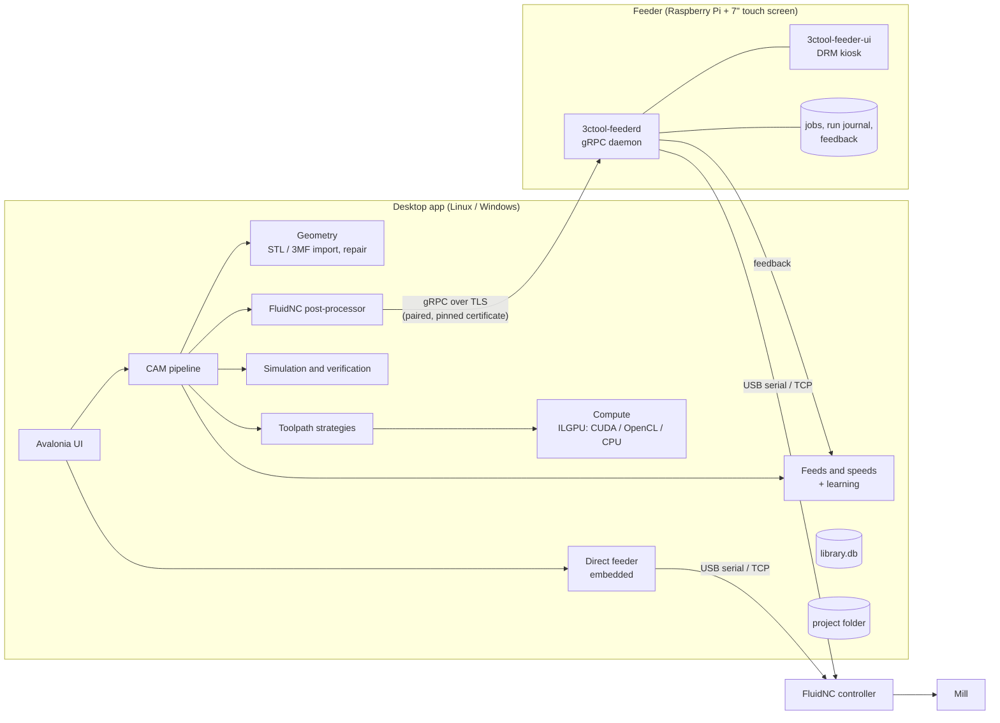

# 3C Tool – Classic Car EVO CNC Control Tool

3C Tool is a complete CAM and machine-control suite for a hobby/prototyping CNC mill driven by a
[FluidNC](https://github.com/bdring/FluidNC) controller. It covers the whole chain from a 3D model to a finished
part:

- **Desktop app** (Linux and Windows): import a model, define stock and setups, generate GPU-accelerated
  toolpaths, simulate and verify them, post FluidNC G-code and send it to the machine.
- **Feeder** (Raspberry Pi with a touch screen, next to the mill): stores the jobs, streams them to the
  controller, handles jogging, probing, operator prompts and crash recovery, and collects operator feedback.
- **Learning loop**: feedback, overrides and tool wear from the feeder flow back to the desktop and adjust the
  feeds and speeds for the next job.

It was built for the "3C" mill (X 1300 × Y 750 × Z 600 mm, rotary A axis around X, 2.2 kW spindle with manual
speed dial, FluidNC on a PiBot V5.88 Ultra board), but every machine property lives in an editable machine
profile that can be imported straight from the controller's FluidNC configuration.

> **Safety:** 3C Tool's Stop and Pause buttons are software functions, not safety functions. Always have a
> hardware emergency stop within reach. Verify every job in the simulator before you run it, and stay at the
> machine while it is cutting.

---

## Contents

- [Architecture](#architecture)
- [Project status](#project-status)
- [Requirements](#requirements)
- [Installation](#installation)
  - [Desktop app (from source)](#desktop-app-from-source)
  - [Feeder on a Raspberry Pi (GitHub build)](#feeder-on-a-raspberry-pi-github-build)
  - [Building the feeder package yourself](#building-the-feeder-package-yourself)
- [Getting started: from model to part](#getting-started-from-model-to-part)
- [Feature list](#feature-list)
- [Data locations](#data-locations)
- [Repository layout](#repository-layout)
- [Development](#development)
- [License](#license)

---

## Architecture



The desktop app can reach the machine in two ways:

1. **Via a paired feeder** – the normal workshop setup. The Pi stays with the mill and keeps running the job
   even if the desktop computer is switched off.
2. **Direct connection** – the feeder service runs inside the desktop app and talks to the controller over USB
   serial or TCP. The machine page then shows the same Jobs/Run/Jog/Setup screens as the Pi.

---

## Project status

| Area | Status |
|------|--------|
| Milling CAM (3-axis, indexed 4th axis, simultaneous rotary) | Implemented |
| Simulation, verification, playback, video export | Implemented |
| FluidNC post-processor | Implemented |
| Feeds and speeds engine + learning from feedback | Implemented |
| Streaming, jogging, probing, crash recovery | Implemented |
| Raspberry Pi feeder (daemon + touch UI + Debian package) | Implemented |
| Desktop installers (AppImage / MSI) | Planned – the desktop app currently runs from source |
| FDM printing head (`ThreeCTool.Additive`) | Planned – only data-model provisions (toolheads, filaments, print profiles) |
| Drag/tangential knife (`ThreeCTool.Cutting`) | Planned – only data-model provisions (ply books, flat patterns, nesting) |
| Moonraker/Klipper integration (`ThreeCTool.Thermal`) | Planned – placeholder project |

---

## Requirements

### Desktop app

| Requirement | Notes |
|-------------|-------|
| Linux (x64) or Windows 10/11 (x64) | macOS is untested. |
| [.NET SDK 10](https://dotnet.microsoft.com/download/dotnet/10.0) | `global.json` pins SDK 10.0.401 and rolls forward to later feature bands. |
| OpenGL 3.3 graphics | Any current GPU or integrated graphics. On Linux, `--gles` switches to OpenGL ES 3.0. |
| *(optional)* NVIDIA CUDA driver or an OpenCL runtime | Toolpath generation and simulation run on the GPU when one is found. Without one they fall back to the CPU (slower, same results). |
| *(optional)* [ffmpeg](https://ffmpeg.org/) | Only needed for MP4 video export of a simulation. It is looked up next to the app and on the `PATH`. |
| *(optional)* USB serial access | Needed for a direct connection or a FluidNC config import over USB. On Linux, add your user to the `dialout` group. |

### Feeder

| Requirement | Notes |
|-------------|-------|
| Raspberry Pi 4 or 5 | Other 64-bit ARM boards that run Debian should also work. |
| 64-bit Raspberry Pi OS (Bookworm or later), Lite recommended | The package depends on `libssl3`, so you need Debian 12+. No .NET install is needed: the package is self-contained. |
| Touch screen (designed for the official 7" 800×480 display) | The UI runs full screen on the DRM/KMS console without a desktop environment. |
| Connection to the FluidNC controller | USB serial (`/dev/ttyUSB*` / `/dev/ttyACM*`) or TCP (Wi-Fi/Ethernet). |
| Network connection to the desktop | gRPC over TLS on port **50051**. |

---

## Installation

### Desktop app (from source)

There are no desktop installers yet. You run the app from source with the .NET SDK.

#### Linux

```bash
# 1. Install the .NET 10 SDK (or use your distribution's package)
curl -sSL https://dot.net/v1/dotnet-install.sh -o dotnet-install.sh
bash dotnet-install.sh --channel 10.0
export PATH="$HOME/.dotnet:$PATH"

# 2. Get the source
git clone https://github.com/schilpr-TT/3CTool.git
cd 3CTool

# 3. Build and start (Release mode)
./run.sh
```

`run.sh` adds `~/.dotnet` to the `PATH` if `dotnet` isn't found, then runs
`dotnet run --project src/ThreeCTool.Desktop -c Release`. Any arguments are passed on to the app, for example
`./run.sh --gles`.

Optional extras:

```bash
sudo apt install ffmpeg              # MP4 video export
sudo usermod -aG dialout "$USER"     # USB serial access (log out and in again)
```

#### Windows

```powershell
winget install Microsoft.DotNet.SDK.10
winget install Git.Git
winget install ffmpeg                # optional, for MP4 video export

git clone https://github.com/schilpr-TT/3CTool.git
cd 3CTool
dotnet run --project src/ThreeCTool.Desktop -c Release
```

#### Updating

```bash
git pull
./run.sh          # or the dotnet run command on Windows
```

The library and project databases are migrated automatically when the app starts.

---

### Feeder on a Raspberry Pi (GitHub build)

Every CI run on GitHub builds a ready-to-install **arm64 Debian package** of the feeder (daemon + touch UI +
systemd units). It is published as the build artifact **`3ctool-feeder-arm64-deb`**.

#### 1. Download the package

**From the GitHub web UI**

1. Open the repository's **Actions** tab and select the **CI** workflow:
   <https://github.com/schilpr-TT/3CTool/actions/workflows/ci.yml>
2. Pick the latest successful run on `main` (green check).
3. Under **Artifacts**, download **`3ctool-feeder-arm64-deb`**. GitHub delivers it as a ZIP file that contains
   `3ctool-feeder_0.1.0~ci<run>_arm64.deb`.
4. Copy it to the Pi, for example `scp 3ctool-feeder-arm64-deb.zip pi@<pi-host>:` and unzip it there.

**With the GitHub CLI** (works on the Pi itself, after `gh auth login`)

```bash
run=$(gh run list --repo schilpr-TT/3CTool --workflow ci.yml --branch main --status success \
      --limit 1 --json databaseId -q '.[0].databaseId')
gh run download "$run" --repo schilpr-TT/3CTool -n 3ctool-feeder-arm64-deb
```

> Artifacts expire after GitHub's retention period (90 days by default). If the latest run is older,
> re-run the workflow or [build the package yourself](#building-the-feeder-package-yourself).

#### 2. Install

```bash
sudo apt install ./3ctool-feeder_*_arm64.deb
```

`apt` pulls in the runtime libraries (DRM/GBM/EGL/GLES, libinput, fontconfig, OpenSSL …). The post-install
script then:

- creates the system user **`threectool-feeder`** (home and data in `/var/lib/3ctool-feeder`),
- enables and starts **`3ctool-feederd.service`** (gRPC daemon) and **`3ctool-feeder-ui.service`** (touch UI),
- enables the maintenance path units (console / reboot / power off from the touch screen).

#### 3. Boot to the console

The touch UI takes over the screen through DRM/KMS. A desktop environment that holds the display blocks it, so
boot to the console:

```bash
sudo systemctl set-default multi-user.target
sudo reboot
```

The installer prints a warning if it finds a display manager enabled at boot. On Raspberry Pi OS Lite this
step is not needed.

#### 4. Check that it runs

```bash
systemctl status 3ctool-feederd 3ctool-feeder-ui
journalctl -u 3ctool-feederd -f
```

The touch screen should now show the feeder UI.

#### 5. Configure

- **Controller connection** – on the touch screen go to **Setup** and choose serial (pick the port from the
  list) or TCP (host and port of the FluidNC controller).
- **Daemon settings** – `/etc/3ctool-feeder/feeder.json` (a conffile, so upgrades keep your changes):

  ```json
  {
    "Feeder": {
      "DataDirectory": "/var/lib/3ctool-feeder",
      "Port": 50051,
      "UnixSocketPath": "/run/3ctool-feeder/feeder.sock",
      "MaintenanceDirectory": "/run/3ctool-feeder",
      "RotaryRadiusMm": 20,
      "RapidRateMmPerMin": 5000
    }
  }
  ```

  Restart the daemon after you change it: `sudo systemctl restart 3ctool-feederd`.

#### 6. Pair the desktop

1. On the Pi: **Setup → pair a desktop**. The screen shows a **6-digit code**, valid for 5 minutes.
2. On the desktop: **Machine** page → add/pair a feeder, enter the Pi's host name or IP address, check the
   certificate fingerprint and enter the code.
3. The desktop stores a token and pins the feeder's self-signed TLS certificate (SHA-256 fingerprint). From then
   on, every connection is encrypted and authenticated.
4. Paired desktops are listed on the Pi and can be revoked there at any time.

#### Upgrading and removing

```bash
sudo apt install ./3ctool-feeder_<newer>_arm64.deb   # upgrade; a running job is stopped and becomes recoverable
sudo apt remove 3ctool-feeder                        # remove (keeps /etc and /var/lib data)
sudo apt purge 3ctool-feeder                         # remove including configuration
```

---

### Building the feeder package yourself

You need the .NET 10 SDK and `dpkg-deb`. Cross-building works from any Linux x64 machine.

```bash
packaging/feeder/build-deb.sh [version] [rid]

# examples
packaging/feeder/build-deb.sh 0.1.0 linux-arm64    # Raspberry Pi 64-bit  -> artifacts/3ctool-feeder_0.1.0_arm64.deb
packaging/feeder/build-deb.sh 0.1.0 linux-x64      # PC / VM / test bench -> artifacts/3ctool-feeder_0.1.0_amd64.deb
packaging/feeder/build-deb.sh 0.1.0 linux-arm      # 32-bit ARM           -> artifacts/3ctool-feeder_0.1.0_armhf.deb
```

The script publishes the daemon and the touch UI as self-contained binaries (debug symbols stripped) with invariant
globalization (no ICU dependency). It installs them under `/opt/3ctool-feeder` with symlinks in `/usr/bin`, and
packs the systemd units, `feeder.json` and the maintenance helper. Set `OUT=<dir>` to change the output folder
and `MAINTAINER="Name <mail>"` to override the maintainer field.

---

## Getting started: from model to part

1. **Machine profile** – on the **Machines** page, edit the default profile or create a new one. Use
   **Import FluidNC config** (USB or through the feeder) to read axes, travel, steps, max rates, accelerations
   and homing straight from the controller. Then add the spindle, rotary axis, probe (tool setter or touch
   plate), safe Z, coolant/dust collection, collets and toolheads.
2. **Library** – add your tools (type, diameters, flutes, lengths, stickout, holder, material) and check the
   built-in materials and stock sizes.
3. **Project** – create a project folder and pick the machine and material. Set the tolerances and the
   optimisation goal (quality, speed or tool life).
4. **Parts** – import STL or 3MF models. Choose the units for STL, check the repair report, and let the app
   orient and place the part.
5. **Stock** – choose box, cylinder or mesh stock (or a library stock size), the margins, and optional tiling of
   several pieces. Add keep-out zones for clamps and fixtures.
6. **Setups and operations** – on the **Machining** page, add setups (3-axis, indexed or simultaneous rotary;
   G54–G59; WCS reference; stock face for hand-flips). Then add operations with a strategy and a tool. The feeds
   and speeds are computed automatically, and you can override them.
7. **Generate** – toolpaths are computed on the GPU (or CPU) and cached in the project.
8. **Simulate and verify** – play back the material removal and review the verification report (gouges,
   collisions, travel limits, leftover material, cycle time) and the deviation heatmap. Optionally export an
   MP4 video.
9. **Post** – write FluidNC G-code: one file per tool per setup (and per piece).
10. **Run** – upload to the paired feeder (or the direct connection), set the work zero / probe, and start.
    Pause, change the feed override, log RPM changes and answer prompts from the touch screen.
11. **Feedback** – after the run, rate the finish, chatter and wear on the feeder. The **Learning** page syncs
    the feedback and adjusts future feeds and speeds for that material, tool and strategy.

---

## Feature list

### Desktop application

- Avalonia 12 desktop UI for Linux and Windows. The main pages are **Project**, **Machining**, **Machine**,
  **Library** and **Settings**, with sub-views for parts, stock, keep-outs, project details, tools, materials,
  stock sizes, machines and learning.
- 3D viewport (OpenGL 3.3 / OpenGL ES 3.0) with an orbit camera. It shows the part, stock, keep-out zones,
  toolpaths, the in-process stock and the deviation heatmap.
- Background computation with progress reporting and cancellation.
- `--gles` command-line switch to run the OpenGL ES 3.0 shader path on a Linux desktop.

### Machine profiles

- Axes X, Y, Z, A, B: travel, steps/mm, max rate, acceleration, homing, imported from FluidNC
  `$Config/Dump`.
- Mismatch warnings when the stored profile and the live controller config differ, plus a controller version
  check.
- Spindle: RPM range and power. A manual speed dial is supported: the G-code prompts the operator for the RPM.
- Rotary axis (A around X).
- Probe: tool setter or touch plate (thickness, travel, feed).
- Safe Z, coolant (none/mist/flood), dust collection, arc-fitting parameters.
- Collets and toolheads (spindle; FDM and knife are provisioned for later).
- Controller connection over USB serial or TCP, with a connection test.

### Tool and material library

- Tool types: **flat end, ball end, bull nose, V-bit, tapered ball, chamfer**. Carbide or HSS.
- Tool status tracking: in stock, worn, broken, retired, with a wear log.
- Built-in materials with cutting data: aluminium 6061/6082 and 7075, acrylic (PMMA), POM (Delrin), HDPE,
  nylon (PA), PVC, hardwood, softwood, plywood, MDF, PU modelling/tooling board, EPS/XPS foam, carbon
  fibre/G10.
- Stock sizes library.
- Built-in filaments and print profiles (for the planned FDM head).
- Projects keep a snapshot of the library entities they use, so later library edits don't change existing
  projects.

### Model import and geometry

- **STL** (binary and ASCII). Units are chosen on import because STL has none.
- **3MF**: units, component trees, the production extension (external model parts) and named bodies. The body
  role (mill/print) is inferred from the body name.
- Mesh repair (welding, hole filling) with a repair report (non-manifold edges, holes, watertightness).
- Automatic orientation and placement on the stock (anchors such as bottom-left or centre).
- Mesh slicing, clipping, a BVH for ray queries, and Clipper2-based polygon offsetting.

### Stock, setups and fixtures

- Stock types: **box**, **cylinder** (for rotary work) and **mesh** (casting or pre-machined blank).
- Tiling of several pieces on one stock, optionally as separate setups.
- **Keep-out zones** (boxes/cylinders with clearance) for clamps, vices and fixtures. On rotary setups they
  either turn with the A axis (clamps, chuck jaws) or stay fixed (headstock, tailstock).
- Holding **tabs** that keep pieces attached to the stock.
- Setup orientations: **3-axis**, **indexed 4th axis** and **simultaneous rotary**.
- Work offsets **G54–G59**. WCS reference: stock top centre, stock top front-left, part origin or rotary axis.
- Stock faces (top/bottom/front/back/left/right) for hand-flip machining of all sides of a box.
- Project tolerances (model, toolpath, deviation) and optimisation goal (quality / speed / tool life).

### Toolpath strategies

| Strategy | Description |
|----------|-------------|
| **Adaptive roughing** | Constant-engagement clearing with an offset or raster pattern and a limited radial engagement. |
| **Z-level roughing** | Level-by-level clearing. Flat areas get their own levels, but only clear the region the regular level below can't reach (no re-cutting of already-cleared planes). |
| **Parallel finishing** | Raster finishing at a chosen angle and stepover, by drop-cutter. |
| **Waterline** | Constant-Z contours for steep walls, by push-cutter. |
| **Scallop** | Constant-scallop offsets across the surface. |
| **Rest machining** | Removes only the material left by a previous, larger tool. |
| **Pencil** | Traces concave corners and fillets. |
| **Rotary roughing** | Roughing around the A axis on cylinder stock. |
| **Rotary finishing** | Simultaneous 4-axis finishing with spiral, ring or line patterns. |

Common operation parameters:

- Cut direction: climb, conventional or both.
- Boundary: stock or part silhouette.
- Entry: plunge, ramp or helix.
- Linking: stay down or retract.
- Stepover, stepdown and stock to leave, plus depth limits.
- Tool assembly (tool + holder) collision checking during generation.
- Toolpaths are cached in the project (`.3ctp`) and regenerated only when their inputs change.

### GPU compute

- ILGPU kernels with automatic backend choice: **CUDA → OpenCL → CPU**.
- Drop-cutter (grid and rotary), push-cutter, collision sweeps, engagement maps, surface projection, 2D/3D
  distance fields and dexel stock.
- Memory-budgeted batching, so large jobs fit on small GPUs.

### Simulation and verification

- Dexel-based material removal on the in-process stock.
- **Verification report** with issues per move:
  - gouges into the part,
  - stock collisions (shank/holder),
  - rapid collisions, part collisions, keep-out collisions,
  - travel-limit violations,
  - stock-model capacity and missing data,
  - feed reductions by the engagement limiter.
- **Deviation summary**: maximum gouge, maximum and mean leftover, and a colour **heatmap** on the part.
- Cycle-time estimate based on the controller's accelerations, plus removed volume per step.
- **Playback** with a time slider at 1×, 10×, 50×, 200× and 1000×. The in-process stock is rebuilt at any point
  in time.
- **MP4 video export** through ffmpeg: 1280×720 up to 3840×2160, 24–60 fps, 15 s up to 5 min total length.

### Post-processor (FluidNC)

- Header comments: project, setup, tool, material, spindle speed, estimated time and input hashes.
- M0 operator prompts for tool changes and piece/stock turns, including the RPM to set on a manual spindle.
- Touch-plate / tool-setter probing sequences wrapped in `(MC:PROBE BEGIN …)` / `(MC:PROBE END)` markers, so
  recovery can re-run them.
- Spindle (M3 S…), coolant and dust-collection control.
- **Arc fitting** to G2/G3 in the G17, G18 and G19 planes, with configurable tolerance, minimum radius and
  maximum sweep.
- **Inverse-time feed (G93)** for simultaneous rotary moves.
- One file per tool per setup (and per piece).
- Lines are kept within 120 characters to fit FluidNC's receive buffer, and files are written atomically.

### Feeds, speeds and learning

- A physics-based feeds and speeds engine:
  - chip load per tool material and work material,
  - radial chip thinning,
  - the spindle power curve,
  - an engagement limiter that lowers the feed in heavy-engagement zones.
- **Learning corrections** per *(material, tool, strategy)*. They are fed by:
  - operator ratings (finish, chatter, wear 1–5),
  - feed overrides and RPM changes during the run,
  - wear and breakage events.
- Each correction step is limited and the result is clamped, so one bad run can't wreck the numbers.
- The **Learning** page syncs feedback from the feeders and shows every correction with its history. Each
  correction can be reset.

### Streaming and machine control

- Transports: USB serial and TCP.
- FluidNC protocol handling: status reports, alarms, errors, real-time commands.
- Character-counting streaming that keeps the planner full without overflowing the controller's receive
  buffer.
- Pause, resume, stop; feed override; spindle RPM logging; `(MC:ASK …)` operator prompts in the G-code.
- **Z guard**: checks before sending each move that the tool stays within travel and doesn't go below the table
  (taking stickout into account). It faults the job before an unsafe move is sent.
- **Run journal** in SQLite. Every run is journalled, so after a crash, power loss or e-stop the job is
  recoverable.
- **Recovery wizard**: re-home, restore offsets, re-probe, rebuild the modal state (units, plane, feed mode,
  spindle, coolant), then re-enter just before the interrupted line with a safe approach and reduced plunge
  feed.
- Jogging: fixed steps or press-and-hold continuous jogging with a keep-alive watchdog. Jogging stops by itself
  if the connection or the touch is lost.
- Home, unlock, reset, set work zero and touch-plate probing.

### Feeder (Raspberry Pi)

- Touch UI for 800×480 screens with the tabs **Jobs**, **Run**, **Jog** and **Setup**, and post-run
  **feedback** and **recovery** screens.
- **Jobs**: list, preview (toolpath drawing), delete. Uploads are verified with SHA-256.
- **Run**: progress, start/pause/resume/stop, feed override, spindle RPM entry, operator prompts, alarms and
  warnings.
- **Jog**: step and continuous jogging, home, unlock, reset, set work zero, touch-plate probe.
- **Setup**: controller connection (serial with port scan, or TCP), pairing and revoking desktops, settings.
- **Maintenance**: switch to a console login, reboot or power off from the touch screen. These go through
  root-owned systemd path units, so the UI itself never needs root.
- **Feedback**: after each run, rate finish, chatter and wear (1–5), log wear/breakage/replacement events, add
  notes, or skip.
- **Run logs** with event timelines: start, pause, resume, prompts, overrides, stop.
- Reads the FluidNC configuration from the controller and hands it to the desktop for import.
- The same screens are available on the desktop's **Machine** page for the direct connection or any paired
  feeder.

### Networking and security

- gRPC services:
  - **Pairing** (unauthenticated, only hello and pair),
  - **Feeder** (jobs, control, manual control, status/event streams, feedback, run logs, controller config),
  - **LocalAdmin** (pairing codes, settings, maintenance, serial ports). LocalAdmin is only reachable through
    the local Unix socket `/run/3ctool-feeder/feeder.sock`.
- Remote access uses **TLS with a self-signed certificate** that the desktop pins by SHA-256 fingerprint, plus a
  **bearer token** issued at pairing.
- Pairing uses a 6-digit code shown on the Pi. The code expires after 5 minutes and failed attempts are
  limited.
- Pairings can be revoked on the Pi.
- On the desktop, stored tokens are protected per user.
- systemd hardening of the daemon: dedicated user, `NoNewPrivileges`, `ProtectSystem=strict`,
  `ProtectHome`, `PrivateTmp`. Only the groups it needs: `dialout` for the daemon; `video`, `render` and
  `input` for the UI.

---

## Data locations

| What | Linux | Windows |
|------|-------|---------|
| Library database (machines, tools, materials, learning, pairings) | `~/.local/share/3CTool/library.db` | `%LOCALAPPDATA%\3CTool\library.db` |
| Direct-connection feeder data | `~/.local/share/3CTool/direct/` | `%LOCALAPPDATA%\3CTool\direct\` |
| Project folder | any folder you choose | any folder you choose |

A project folder contains:

```
<project>/
├── project.db      # setups, operations, stock, keep-outs, library snapshot (SQLite)
├── project.yaml    # human-readable project metadata
├── models/         # imported models (copied into the project)
├── toolpaths/      # cached toolpaths (.3ctp)
└── gcode/          # posted G-code files
```

On the feeder (Pi):

| What | Path |
|------|------|
| Binaries | `/opt/3ctool-feeder/{feederd,ui}`, symlinked as `/usr/bin/3ctool-feederd` and `/usr/bin/3ctool-feeder-ui` |
| Configuration | `/etc/3ctool-feeder/feeder.json` |
| Jobs, run journal, feedback, pairings, settings | `/var/lib/3ctool-feeder/` |
| Local socket and maintenance requests | `/run/3ctool-feeder/` |
| systemd units | `3ctool-feederd.service`, `3ctool-feeder-ui.service`, `3ctool-feeder-maintenance@{console,reboot,poweroff}.path` |

---

## Repository layout

| Project | Purpose |
|---------|---------|
| `src/ThreeCTool.Core` | Domain model: machines, toolheads, tools, materials, projects, setups, operations. |
| `src/ThreeCTool.Data` | EF Core SQLite library and project databases, migrations, built-in library. |
| `src/ThreeCTool.Geometry` | STL/3MF import, mesh repair, slicing, clipping, BVH, polygons, placement. |
| `src/ThreeCTool.Compute` | ILGPU kernels: drop/push-cutter, collisions, engagement, distance fields, dexels. |
| `src/ThreeCTool.Toolpaths` | Toolpath strategies, tabs, tool assemblies, setup frames. |
| `src/ThreeCTool.Simulation` | Material removal, verification report, deviation, playback. |
| `src/ThreeCTool.Post` | FluidNC milling post-processor and arc fitter. |
| `src/ThreeCTool.Feeds` | Feeds and speeds engine and learning corrections. |
| `src/ThreeCTool.Streaming` | Transports, FluidNC protocol, config import, job streamer, Z guard, recovery. |
| `src/ThreeCTool.Rendering` | OpenGL / OpenGL ES rendering, camera, software rasteriser. |
| `src/ThreeCTool.Desktop` | Avalonia desktop application. |
| `src/ThreeCTool.Feeder.Contracts` | gRPC/protobuf contracts (`feeder.proto`). |
| `src/ThreeCTool.Feeder.Service` | Feeder daemon: gRPC server, job store, controller, pairing, journal. |
| `src/ThreeCTool.Feeder.Client` | Feeder view models shared by the touch UI and the desktop's machine page. |
| `src/ThreeCTool.Feeder` | Feeder touch UI (DRM kiosk). |
| `src/ThreeCTool.Additive`, `.Cutting`, `.Thermal` | Placeholders for FDM, knife and Moonraker support. |
| `tests/ThreeCTool.*.Tests` | xUnit tests per project, including headless Avalonia UI tests. |
| `tests/ThreeCTool.Gpu.Tests` | Tests that need a real GPU (`Category=Gpu`). |
| `tests/ThreeCTool.FluidNcSimulator` | Simulated FluidNC controller (serial PTY / TCP) for integration tests. |
| `tests/ThreeCTool.MoonrakerMock` | Placeholder mock for the planned Moonraker integration. |
| `packaging/feeder` | Debian packaging: build script, control files, systemd units, config. |
| `3CTool_Plan.md` | The full design and planning document. |

---

## Development

### Build and test

```bash
dotnet build ThreeCTool.slnx -c Release
dotnet test  ThreeCTool.slnx -c Release --filter "Category!=Gpu"
```

- Warnings are treated as errors, nullable reference types are on, and the latest recommended analyzers run.
- NuGet versions are managed centrally in `Directory.Packages.props`.
- The video export tests are skipped when ffmpeg isn't installed.
- GPU tests (`Category=Gpu`) need a CUDA or OpenCL device:
  `dotnet test tests/ThreeCTool.Gpu.Tests -c Release`.

### Continuous integration

| Workflow | Trigger | What it does |
|----------|---------|--------------|
| `.github/workflows/ci.yml` → **build-test** | push to `main`, pull requests | Builds and tests on `ubuntu-latest` and `windows-latest`. Feeder tests, other tests and desktop UI tests run as separate steps. |
| `.github/workflows/ci.yml` → **feeder-linux-arm64** | push to `main`, pull requests | Builds the arm64 feeder `.deb` and uploads it as the **`3ctool-feeder-arm64-deb`** artifact. |
| `.github/workflows/gpu.yml` | manual (`workflow_dispatch`) | Runs the GPU tests on a self-hosted runner labelled `self-hosted, linux, gpu`. |

### Main technologies

.NET 10 · C# · Avalonia 12 · CommunityToolkit.Mvvm · ILGPU · Silk.NET OpenGL · EF Core + SQLite · gRPC +
Protobuf · Clipper2 · xUnit

---

## License

[MIT](LICENSE) – Copyright (c) 2026 TenTwenty Media BV.
